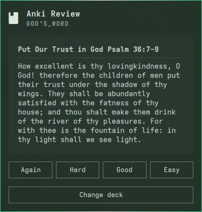

# Anki Review for Omarchy

Review any Anki deck from the Omarchy bar. Pick a deck, reveal each answer,
and send a rating to Anki Desktop. Anki's reviewer selects the next card
and records your review.



After revealing the answer, choose **Again**, **Hard**, **Good**, or **Easy**.

## Requirements

- Omarchy 4.5 with its Quickshell bar
- Python 3
- Anki Desktop running with [AnkiConnect](https://ankiweb.net/shared/info/2055492159)
  installed. In Anki, use **Tools → Add-ons → Get Add-ons**, enter
  `2055492159`, and restart Anki once to load the add-on. The widget can
  then connect to your existing Anki session. Keep the add-on on its default local
  address, `127.0.0.1:8765`. This plugin uses the default configuration
  without an API key.

## Install

Once this repository is hosted, install it with
`omarchy plugin add <repository-git-url> --enable`.

For a local checkout, run these commands from its root in a new installation:

```sh
omarchy plugin validate .
mkdir -p ~/.config/omarchy/plugins/anki.review
cp -r manifest.json ReviewWidget.qml bridge.py i18n ~/.config/omarchy/plugins/anki.review/
omarchy-shell shell rescanPlugins
omarchy plugin enable anki.review
```

## Background startup

When AnkiConnect is unreachable, **Start in background** launches Anki in the
hidden Hyprland workspace `special:anki-review` and waits for the deck list.
An already connected Anki session is reused. If Anki is open without a working
AnkiConnect instance, check the add-on in the existing window.

Open or hide that workspace with:

```sh
hyprctl dispatch 'hl.dsp.workspace.toggle_special("anki-review")'
```

For optional startup at login, add this to your Omarchy
`~/.config/hypr/autostart.lua`:

```lua
hl.on("hyprland.start", function()
  hl.exec_cmd("anki", { workspace = "special:anki-review silent" })
end)
```

If Anki is installed in your home directory and is missing from Hyprland's
PATH, replace `"anki"` with the full path to its launcher.

## Review and sync

Open **Anki** in the bar, pick a deck, and click **Review**. Use **Show answer**
and one of the rating buttons. Keep a single active reviewer session and
switch to Anki Desktop for cards that depend on images, audio, or custom
template behavior. The bar displays the text extracted from the question and
answer.

To share progress with AnkiDroid, sync both apps through the same AnkiWeb
account. After a widget session, sync Anki Desktop and then AnkiDroid.
[Anki sync manual](https://docs.ankiweb.net/syncing.html).

If the widget loses its connection while submitting a rating, check the
active card in Anki Desktop before continuing. Ratings require an explicit click.

## Source

`ReviewWidget.qml` renders the popup and manages the review controls.
`bridge.py` talks to the local AnkiConnect API and prepares plain text for
the popup. `manifest.json` registers the bar widget with Omarchy.

## Remove

Run `omarchy plugin disable anki.review` to hide the widget.
For a Git installation, run `omarchy plugin remove anki.review` to uninstall it.

## Publish

Push this repository to public GitHub, then follow the
[Omarchy marketplace publishing guide](https://plugins.omarchy.org/publish.html).
The project is available under the [MIT License](LICENSE).
